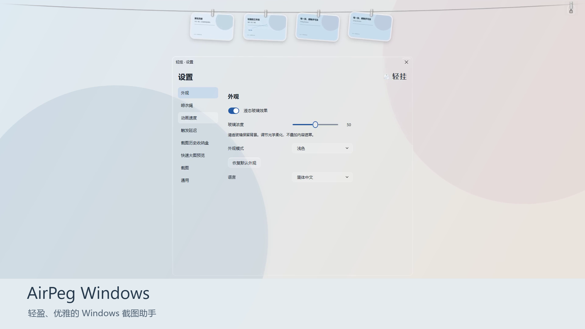

> **原作者致谢 / Original Project Credit**
>
> 轻挂（AirPeg）基于 Alejandro Buján 的开源项目 Tendedero 的设计与交互理念，面向 Windows 平台进行独立复刻、适配与功能扩展。
>
> **原作者：Alejandro Buján**
>
> **原项目：[https://github.com/alejandrobujan/tendedero](https://github.com/alejandrobujan/tendedero)**
>
> AirPeg is an independent and unofficial Windows adaptation inspired by Tendedero, originally created by Alejandro Buján.
>
> This project is not affiliated with or endorsed by the original author.

# 轻挂 AirPeg

**让截图，轻轻挂在桌面上。**

AirPeg 是一款专为 Windows 打造的截图管理工具。

它将截图自然地悬挂在屏幕顶部，让截图的保存、预览、编辑和分享更加直观。

精致的 Liquid Glass 透明界面、自然的物理动画，以及轻量化桌面交互，让每一张截图都触手可及。

[观看或下载完整 90 秒功能演示](https://github.com/liu784/AirPeg/releases/tag/v1.8.5-preview.1) · [从源码构建](BUILDING.md) · [许可证与致谢](NOTICE.md)

当前公开发行 **1.8.5 预览版**。源码和便携包已开放下载；P5 稳定性最终验收尚未完成，本版本保留 Pre-release 标记，不宣称正式稳定版。

## 功能

- 截图自动悬挂，自然物理摆动动画
- 截图编辑与标注
- 截图复制、拖拽和保存
- 截图历史收纳盒（历史持久化默认关闭）
- 快速大图预览，可自定义单键或组合键
- 晾衣绳展开及隐藏速度调节，触发延迟自由调节
- 微型玻璃锁定挂件
- 全屏智能隐藏，快捷键冲突提示与重新指定
- Liquid Glass 透明界面，玻璃浓度滑杆
- 浅色、深色及自动主题
- 默认简体中文，可切换 English

## 运行

下载 Windows x64 自包含便携 ZIP，完整解压后双击 **AirPeg.exe**，无需额外安装 .NET Desktop Runtime。使用 Windows 10/11 x64；实时桌面玻璃需要 Windows 10 2004（19041）及以上与兼容的显卡、驱动和桌面会话。渲染初始化失败时提供低特效界面。

保留与 EXE 同目录的 `portable.flag`。配置、截图及历史保存在该目录的 `Data` 中。升级前退出旧版本、备份并保留 Data，勿在不可信目录运行。托盘菜单用于设置、历史及正常退出。AirPeg 沿用兼容的内部单实例标识，同一会话一次运行一个版本。

按 **Win+Shift+S** 使用系统截图工具；将鼠标移到屏幕顶边展开晾衣绳。单击卡片可复制，拖拽可导出。长按或右键进入已有编辑功能。

## 玻璃与测试边界

设置窗口使用 D3D11 Desktop Duplication、D3D9Ex 共享表面、WPF D3DImage 与原生 GPU Shader，支持实时背景更新；它是独立的 Windows 光学近似实现，并非 Apple 私有渲染引擎。

已验收的 P4 视觉保留。P5 优化仍等待正式稳定性验收。Windows 11、其他 DPI、多显示器、HDR、远程桌面及设备重置等环境没有全部实测通过；详见 [已知限制](docs/KNOWN-LIMITATIONS.md)。演示使用真实 Windows 软件窗口的程序驱动操作，片内保留相关说明，不把自动演示当作全部人工交互测试。

## 构建与技术

C# / .NET 8 / WPF / Win32，实时玻璃桥接采用原生 C++ / D3D。见 [BUILDING.md](BUILDING.md) 与 [源码来源记录](SOURCE-PROVENANCE.md)。开发工具与 SDK 不包含在源码仓库中。

## 开源致谢

感谢 **Alejandro Buján** 的 [Tendedero](https://github.com/alejandrobujan/tendedero)，以及 Windows 基础代码来源 [Snapline](https://github.com/mohabujubara/snapline)。

MIT 源码许可、第三方版权声明与字体许可分别保存在 [LICENSE](LICENSE)、[NOTICE.md](NOTICE.md) 与 [licenses](licenses)。AirPeg 使用独立名称和图标，不使用 Tendedero 原作品牌资产，也不代表原作者背书。

## English

AirPeg is a lightweight Windows screenshot manager with a hanging clothesline, native Liquid Glass UI and natural animations. It defaults to Simplified Chinese and supports English. This public repository provides the 1.8.5 preview release. P5 stability acceptance remains pending; this is not a final stable release. See [build instructions](BUILDING.md), [credits](NOTICE.md) and [known limitations](docs/KNOWN-LIMITATIONS.md).
